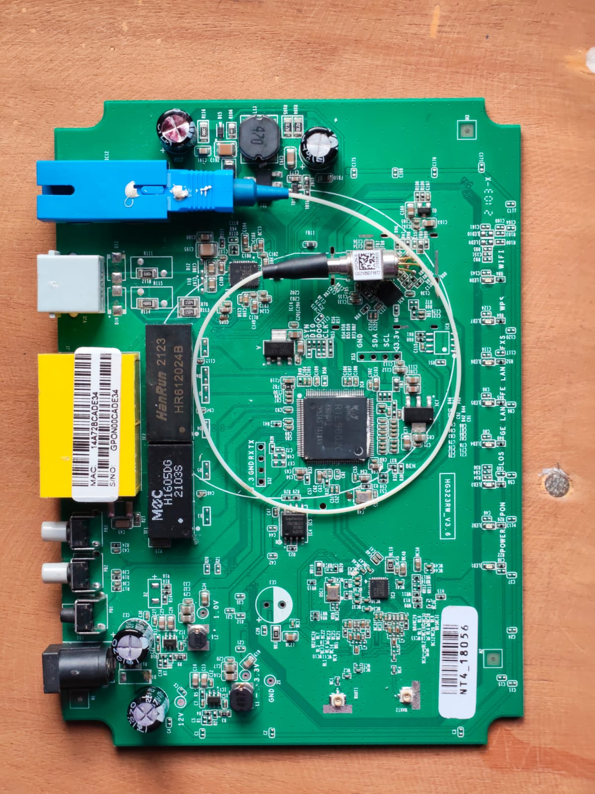
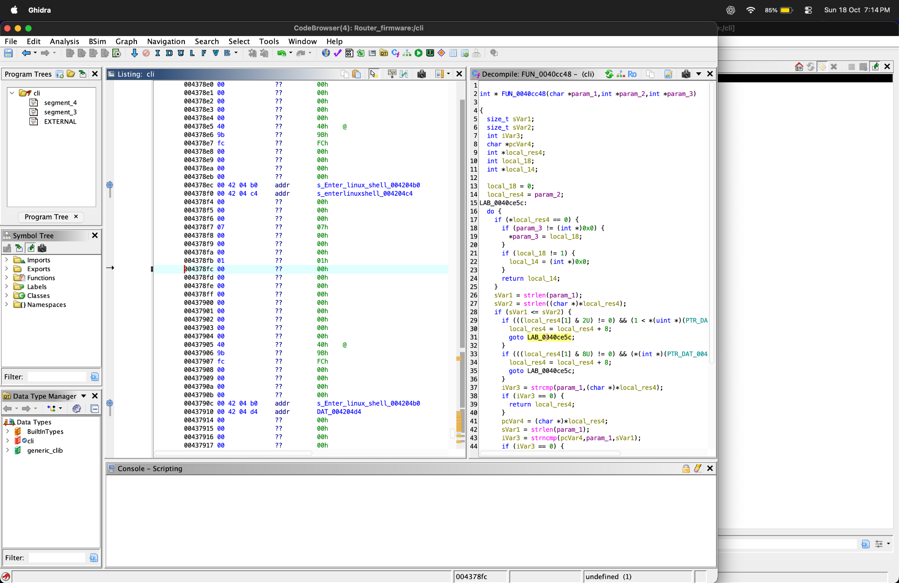
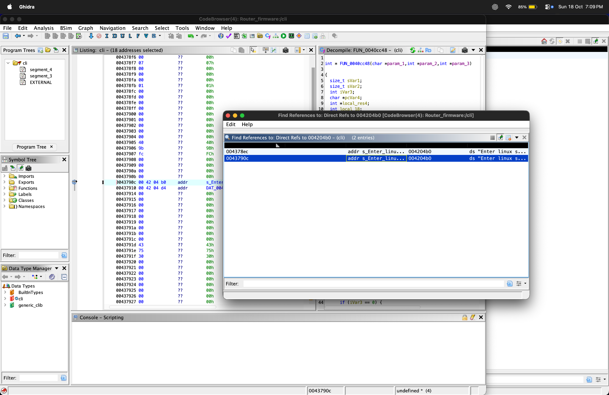
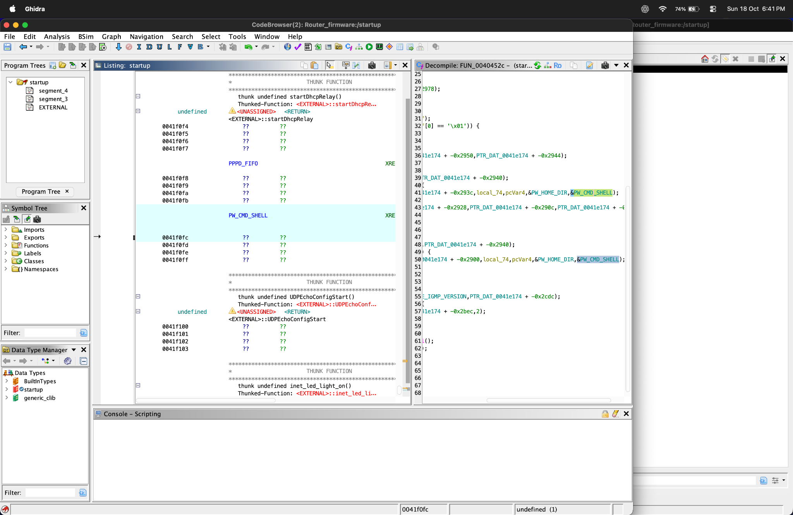

# Netlink HG323RW V3.6 — Linux Shell Access and Firmware Analysis

> A field guide to a personally owned Netlink HG323RW V3.6 / RTL9602C GPON router: hardware console access, offline firmware analysis, the vendor CLI, and Linux inspection.

**Status:** UART root-shell access reported; account metadata confirmed from pasted device output; SSH login not yet demonstrated.

**Documentation date:** 2026-10-18

## Contents

- [Scope and evidence](#scope-and-evidence)
- [Outcome and investigation path](#outcome-and-investigation-path)
- [Hardware and software identification](#hardware-and-software-identification)
- [Architecture and trust boundaries](#architecture-and-trust-boundaries)
- [1. Prepare an isolated bench](#1-prepare-an-isolated-bench)
- [2. Identify and observe UART](#2-identify-and-observe-uart)
- [3. Inspect U-Boot without writing](#3-inspect-u-boot-without-writing)
- [4. Map storage and inspect firmware offline](#4-map-storage-and-inspect-firmware-offline)
- [5. Trace the vendor CLI in Ghidra](#5-trace-the-vendor-cli-in-ghidra)
- [6. Enter Linux and verify identity](#6-enter-linux-and-verify-identity)
- [7. Inspect the system and network](#7-inspect-the-system-and-network)
- [8. Account database findings](#8-account-database-findings)
- [9. Explore SSH without changing the service](#9-explore-ssh-without-changing-the-service)
- [Troubleshooting](#troubleshooting)
- [Security interpretation and limits](#security-interpretation-and-limits)
- [Evidence included in this repository](#evidence-included-in-this-repository)
- [Sources](#sources)

---

## Scope and evidence

This guide preserves the researcher's investigation and provides a conservative reproduction procedure. It is not a claim that every command below was run successfully on this unit.

The evidence now includes the owner's boot log, UART-style hexadecimal dump, conversion script, SquashFS image, extracted filesystem, three Ghidra screenshots, and a PCB photograph, alongside the original conversation's account output. Offline checks reproduced the firmware conversion and matched the CLI binary to the screenshot addresses. Root-shell access remains a reported runtime result: the supplied boot log does not contain a direct `id` or UID-status capture. See the [evidence index](evidence/README.md) and [offline validation record](evidence/offline-validation.md).

**Evidence labels used throughout:**

- **Observed:** supplied logs, photographs, or binary contents inspected directly; each finding identifies its source.
- **Reported:** the researcher or project handoff describes the result, but underlying artifacts are unavailable here.
- **Reference-verified:** an external primary source supports the stated fact, within its stated scope.
- **Hypothesis / pending:** an inference or experiment that still needs confirmation.

Commands in this guide are reproduction instructions, not a verbatim historical transcript. Router commands are inspection-only and do not intentionally change flash or persistent configuration. Opening shells, interrupting boot, and authentication can still change runtime state or produce logs. Offline extraction writes files on the analysis computer.

---

## Outcome and investigation path

The reported investigation progressed through:

1. Identifying the router and locating a usable UART console.
2. Observing boot and exploring the U-Boot environment.
3. Mapping firmware storage and extracting a SquashFS filesystem.
4. Inspecting the vendor CLI in Ghidra and discovering `enterlinuxshell`.
5. Entering a root BusyBox shell and inspecting the Linux system and network.
6. Finding Dropbear and investigating whether SSH could provide equivalent access.

The strongest preserved runtime evidence is the account mapping: the administrator account has UID 0 and launches `/bin/cli`. Another account named nobody also has UID 0 but uses `/dev/null` as its login program. This is unusual and deserves investigation; it does not, by itself, prove that nobody can authenticate.

---

## Hardware and software identification

| Item | Value / finding | Evidence and limit |
| --- | --- | --- |
| PCB revision | HG323RW_V3.6 | Visible silkscreen in the supplied photograph. |
| SoC | Realtek RTL9602C | Boot preloader and board banner; exact suffix not established. |
| CPU / buses | CPU 625 MHz; memory clock 500 MHz; LX 200 MHz; SPI 50 MHz | Boot-reported clocks, not independent electrical measurements. |
| RAM | 128 MB DDR2 | U-Boot report; Linux usable memory is lower. |
| Flash | 1 × 16 MB SPI NOR; ID C84018 | Boot report; no flash-manufacturer inference required. |
| Executable format | ELF32, big-endian MIPS, dynamic /lib/ld-uClibc.so.0 | Direct inspection of bin/cli. |
| Bootloader | Bismarck preloader; U-Boot 2011.12.M | Captured boot banner, build date May 22, 2021. |
| Linux / userspace | Linux 2.6.30.9; BusyBox 1.12.4 | Captured boot log. |
| Root filesystem | SquashFS 4.0, LZMA, 131072-byte blocks, 1104 inodes | Supplied image superblock; filesystem metadata is little-endian even though CLI code is big-endian. |
| SSH software | bin/dropbear; embedded banner SSH-2.0-dropbear_0.48 | Binary inspected; running version, authentication, and listener remain unverified. |
| Wireless | Boot driver identifies RTL8192F series | Driver evidence; exact physical radio model not independently established. |
| Console | ttyS0, 115200 baud | Kernel command line. Voltage and framing not measured in the supplied evidence. |



*Owner-supplied PCB photo, reproduced unchanged at the owner's request. The repeated attachment was the same image and is included once. TX/RX/GND markings are visible beside the four-pad header; confirm orientation and voltage on the actual board before wiring.*

**Reference-verified naming caveat:** Netlink's firmware page lists HG323RGW hardware 3.6 with an HG323RWplus-named image. Its current firmware catalogue separates multiple hardware and firmware families, including VD5 entries. This supports a naming overlap, not proof of interchangeability or an exact chip suffix for this specimen. Do not flash a similarly named image on that basis. [Netlink legacy firmware listing](https://netlinkict.com/netlink-firmwares/) · [Netlink firmware catalogue](https://netlinkict.com/firmwares/)

The hardware values above are supported by the supplied photo and [boot excerpts](evidence/boot-excerpts.txt). Linux MemTotal is usable memory, not necessarily installed DRAM capacity. Boot-reported values are not independent measurements.

---

## Architecture and trust boundaries

```text
Analysis computer
  |
  +-- USB-to-TTL UART -- board console
  |                       |
  |                       +-- Boot ROM -> U-Boot -> Linux kernel
  |                                                 |
  |                                                 +-- init / startup scripts
  |                                                       |
  |                                                       +-- vendor /bin/cli
  |                                                             |
  |                                                             +-- enterlinuxshell
  |                                                                   |
  |                                                                   +-- BusyBox shell
  |
  +-- isolated Ethernet LAN -- bridge / management address
                                |
                                +-- Dropbear? -> account lookup -> /bin/cli?
                                    [listener and SSH path not confirmed]

Offline firmware copy -> container / partition identification
                      -> SquashFS extraction -> /bin/cli -> Ghidra
```

The diagram is a conceptual model of the reported workflow, not a recovered schematic or a verified complete boot call graph.

```text
Router TX  ---------------->  Adapter RX
Router RX  <----------------  Adapter TX  [connect after identification]
Router GND -----------------  Adapter GND
Router VCC       X            Adapter VCC [leave disconnected]
```

---

## 1. Prepare an isolated bench

Use the owner's device, its normal power supply, a multimeter, a USB-to-TTL adapter with verified compatible I/O voltage, a serial terminal, and an isolated Ethernet connection. A logic analyzer or oscilloscope helps identify TX and baud rate.

- Disconnect the provider fiber before experimenting; cap the connector and never look into an optical port.
- Keep the router off production networks. Do not bridge the bench network to a WAN.
- Power off before attaching or moving leads. Check ground continuity only on an unpowered board.
- Do not use RS-232 voltage levels or assume that an adapter's power-voltage selector also changes its TX logic level.
- Leave adapter VCC disconnected. Power the router through its normal supply.
- Avoid slipping probes, ESD, and pin shorts. Do not copy a pin order from another revision.

Keep raw logs and firmware privately. Redact passwords, all password hashes, Wi-Fi keys and SSIDs, MAC/BSSID values, public addresses, serial numbers, GPON credentials, LOID/PLOAM values, PPPoE credentials, private keys, and subscriber or ISP identifiers before sharing.

---

## 2. Identify and observe UART

**Observed evidence:** the supplied serial boot capture is readable, and its kernel command line specifies `console=ttyS0,115200`. The PCB photo shows console-pad labels. Adapter wiring, measured I/O voltage, and terminal framing were not captured.

1. Photograph the board with a clear orientation reference; mask device labels in the publication copy.
2. With power removed, identify ground using continuity to a known ground point.
3. With power applied carefully, measure candidate signals relative to ground. A supply-like steady level alone does not establish TX or RX.
4. Identify TX by its boot-time transitions. Measure its voltage and bit timing; configure a compatible receiver.
5. Initially connect only board TX to adapter RX and common ground. Capture readable boot output.
6. Connect adapter TX to the confirmed board RX only after validating electrical compatibility and pin identity.

On macOS, discover the serial device:

```sh
ls /dev/cu.*
```

The captured Linux console is configured for 115200 baud. Verify framing and electrical compatibility on your board; 8N1 with no flow control is a starting hypothesis, not a preserved measurement. Replace SERIAL_DEVICE with your adapter path:

```sh
screen SERIAL_DEVICE 115200
```

**Acceptance criterion:** repeatably legible boot text and controlled input without resets or corrupted characters. Save a redacted boot capture containing the bootloader banner, kernel banner, and storage messages.

---

## 3. Inspect U-Boot without writing

**Observed evidence:** the log records `U-Boot 2011.12.M (May 22 2021 - 14:20:00)` and an autoboot prompt saying to hit any key. It also records DRAM, flash, and partition configuration. It does not preserve an interactive U-Boot session or a complete environment dump.

Interrupt autoboot only using the prompt's documented key. If a password is requested, use an authorized credential. Do not infer that every build permits interruption.

At the U-Boot prompt, inspect available commands first:

```text
help
version
```

If listed by this build, use:

```text
bdinfo
printenv
```

These are inspection commands in standard U-Boot; vendor builds can differ. Inspect boot arguments and partition descriptions privately, then publish only sanitized relevant lines. Environment output can contain device addresses and credentials. [U-Boot printenv reference](https://docs.u-boot.org/en/latest/usage/cmd/printenv.html)

Do not run saveenv, erase, flash-write, upgrade, memory-write, or reset-to-default operations as part of this guide. Do not probe arbitrary MMIO addresses: some reads have side effects.

**Acceptance criterion:** a recorded bootloader version, documented command set, and evidence for the actual boot path. An interrupted boot is not evidence of a successful flash dump.

---

## 4. Map storage and inspect firmware offline

**Observed evidence:** the supplied conversion script parses U-Boot-style `md.b` rows beginning at `0xB4500000` for `0x521B3F` bytes. A rerun recovered **5,380,927 bytes with zero missing, duplicate, or conflicting bytes**, and the result matched the supplied SquashFS byte for byte. This verifies reconstruction consistency; it does not authenticate the original capture.

Root filesystem SHA-256:

```text
0308c4d98b54ba6cc40db90651745e5777f465f2a4b55f5e2b2c7328eab55d57
```

The boot partition string implies these sequential flash offsets; ends are exclusive:

| Partition | Start | End | Size |
| --- | --- | --- | --- |
| boot | 0x000000 | 0x040000 | 256 KiB |
| env | 0x040000 | 0x042000 | 8 KiB |
| env2 | 0x042000 | 0x044000 | 8 KiB |
| config | 0x044000 | 0x100000 | 752 KiB |
| k0 | 0x100000 | 0x500000 | 4 MiB |
| r0 | 0x500000 | 0xD00000 | 8 MiB |
| framework1 | 0xD00000 | 0x1000000 | 3 MiB |

These offsets are calculated from the logged partition string. The image's 5.13 MiB of used data fits within the 8 MiB r0 partition. The script's mapped address is consistent with an inferred `0xB4000000` flash window; do not confuse a CPU-mapped address with a file offset.

The owner-provided [conversion script](tools/hex_to_bin.py) is included unchanged. Run it on a working copy in a directory containing `rootfs_combined.hex`; it writes `rootfs.squashfs`. Its address and size constants are specific to this capture. See [validation details](evidence/offline-validation.md).

Once Linux shell access exists, inspect the runtime map:

```sh
cat /proc/mtd
cat /proc/mounts
cat /proc/cmdline
```

Record partition names, sizes, and erase sizes. Do not assume /proc/mtd gives partition start offsets, or that a vendor upgrade package is a raw full-flash image.

Work from an already acquired authorized firmware copy. No new on-device dump or flash operation is prescribed here. Keep the original unchanged and analyze a working copy as an unprivileged user in a disposable workspace.

On the analysis computer:

```sh
shasum -a 256 firmware.bin
file firmware.bin
binwalk --help
binwalk firmware.bin
unsquashfs -help
```

The filenames are local placeholders. Record tool versions. Binwalk syntax varies by release; a signature match is a candidate filesystem, not validation. Do not automatically execute extracted content.

For a standalone SquashFS image:

```sh
unsquashfs -s rootfs.squashfs
unsquashfs -d extracted-rootfs rootfs.squashfs
```

For a filesystem embedded in a larger image, first establish the actual byte offset from consistent signature, superblock, and boundary evidence. If the installed extractor supports -offset, substitute that verified decimal offset:

```sh
unsquashfs -s -offset VERIFIED_DECIMAL_OFFSET firmware.bin
unsquashfs -d extracted-rootfs -offset VERIFIED_DECIMAL_OFFSET firmware.bin
```

Check the local help before using this form. Legacy vendor SquashFS variants may need compatible tooling; extraction failure does not by itself prove corruption. [SquashFS tools upstream](https://github.com/plougher/squashfs-tools)

**Validation result:** unsquashfs 4.7.5 recognized SquashFS 4.0 with LZMA and extracted regular files. The extracted CLI exactly matched the supplied extracted_fs/bin/cli. Device-node creation failed under the unprivileged account; this was not a complete recreation of a bootable root filesystem. Digests and tool results are recorded in the evidence folder.

---

## 5. Trace the vendor CLI in Ghidra

**Observed discovery evidence:** the CLI contains `Enter linux shell` at file offset `0x204b0` and `enterlinuxshell` at `0x204c4`. ELF load-segment mapping gives virtual addresses `0x004204b0` and `0x004204c4`, matching the supplied Ghidra labels.



*The listing shows the help-string pointer at 0x004378ec and command-string pointer at 0x004378f0. The visible decompiled FUN_0040cc48 performs string matching and table traversal; this screenshot does not establish that it is the shell-launch handler.*



*Two displayed references, 0x004378ec and 0x0043790c, target the help string at 0x004204b0. These are references to “Enter linux shell,” not direct proof of calls launching a shell.*

The owner reports using the discovered command to obtain Linux shell access. The screenshots substantiate the static discovery; a separate runtime identity capture is still needed to independently verify the root session.

Inspect, but do not execute, the extracted binary:

```sh
file extracted-rootfs/bin/cli
readelf -h extracted-rootfs/bin/cli
strings -a extracted-rootfs/bin/cli | grep -n 'enterlinuxshell'
ls -l extracted-rootfs/etc/passwd
```

Use a host with readelf installed, or an equivalent ELF-header viewer. Follow a CLI symlink only within the extracted filesystem; do not accidentally analyze a host path.

In Ghidra:

1. Import the CLI ELF and check architecture, bitness, endianness, and loader-selected language against its header.
2. Run analysis and locate the command string.
3. Follow references into the command table, parser, and handler.
4. Inspect argument checks, authentication or privilege gates, and calls that launch a shell or change identity.
5. Distinguish a string's existence from a reachable command path. Record the firmware digest, function addresses, and a short sanitized explanation.

Ghidra is the static-analysis tool used for this stage; its output needs interpretation and runtime confirmation. [Ghidra upstream](https://github.com/NationalSecurityAgency/ghidra)

**Hypothesis:** the command handler transitions into a Linux shell. The exact implementation—such as system, exec, or a wrapper—and its authorization logic are not proven by the retained evidence.

---

## 6. Enter Linux and verify identity

From an already authorized vendor CLI session, the reported command was:

```text
enterlinuxshell
```

This is a vendor CLI command, not a BusyBox command. If rejected, stop and record the firmware and prompt context; do not assume the same handler exists on other versions.

Inside the resulting Linux shell:

```sh
id
grep '^Uid:' /proc/$$/status
grep '^Gid:' /proc/$$/status
uname -a
busybox
```

The four Uid values are real, effective, saved-set, and filesystem UIDs. Effective UID 0 establishes root identity for that process; a # prompt alone does not. Using /proc/$$/status targets the current shell. /proc/self/status opened by another command describes that command's process.

**Reported result:** a root BusyBox shell was obtained. Preserve the identity output on a repeat run; the accessible record contains the earlier conclusion but not the original status lines.

If id or grep is unavailable, inspect /proc/$$/status with cat. BusyBox applets vary by firmware build.

---

## 7. Inspect the system and network

Run these from Linux, not U-Boot or the vendor CLI:

```sh
cat /proc/cpuinfo
cat /proc/meminfo
cat /proc/version
cat /proc/mtd
cat /proc/mounts
ps
ifconfig -a
route -n
netstat -lnt
```

Optional commands, only if present:

```sh
brctl show
iptables -L -n -v
iptables -t nat -L -n -v
```

Interpret interfaces, bridge membership, routes, and listening sockets separately. A bridge address identifies a management endpoint; it does not prove WAN connectivity. A listener bound to all IPv4 addresses is not proof of Internet reachability—routing, filtering, and upstream exposure still matter. Hardware forwarding may not be fully represented by Linux bridge or firewall output.

**Reported network finding:** the earlier assistant described br0 with a private IPv4 /24 management subnet. Its exact address is intentionally generalized here; discover your own value with ifconfig.

Do not paste raw interface, process, boot, or firewall output into a public repository. These can expose addresses, MACs, service arguments, or provisioning information.

---

## 8. Account database findings

The supplied /etc/passwd output establishes the following metadata. Account names and the entire password field have been replaced with role labels:

| Role label | UID | GID | Home | Login program |
| --- | --- | --- | --- | --- |
| Administrator account | 0 | 0 | /tmp | /bin/cli |
| “Nobody” role account | 0 | 0 | /tmp | /dev/null |
| Standard user account | 1 | 0 | /tmp | /bin/cli |

For a sanitized metadata view on the router, if awk is available:

```sh
awk -F: '{printf "account-%d uid=%s gid=%s home=%s shell=%s\n", NR,$3,$4,$6,$7}' /etc/passwd
ls -l /etc/passwd
```

- **Observed:** the administrator is a UID 0 account. The standard user has UID 1; GID 0 does not make it root.
- **Observed:** the nobody-named account also has UID 0. /dev/null is not a usable interactive shell, but this does not neutralize all risks of assigning UID 0.
- **Observed:** the supplied extracted filesystem contains the symlink `/etc/passwd → /var/passwd`. The startup screenshot shows references to PW_HOME_DIR and PW_CMD_SHELL. It supports investigation of account initialization but, because the decompiled calls are partly clipped, does not independently establish the complete generation mechanism.



*The startup binary view shows PW_CMD_SHELL at 0x0041f0fc and references in FUN_0040452c. Symbol references alone do not establish runtime contents of /var/passwd.*
- **Observed format:** two password fields used the MD5-crypt marker with an empty salt component. No hash strings are reproduced. This is a password-storage weakness, not evidence that a password has been recovered.

Do not crack, publish, or reuse the supplied hashes. Do not edit accounts or shell fields during this read-only investigation.

---

## 9. Explore SSH without changing the service

**Observed:** the supplied filesystem contains `/bin/dropbear`, with the embedded banner `SSH-2.0-dropbear_0.48`. This is a static version clue, not a live negotiated banner. **Unknown:** whether it runs, where it listens, which authentication policy applies, and whether an SSH login succeeds.

The boot log records attempts to insert an `inacc` rule dropping TCP port 22 on `br0` (original lines 684 and 1314). This may explain unavailable LAN SSH, but the final effective ruleset and listener state are not captured. Nearby firewall errors and later rule changes mean the logged command alone is insufficient to prove the resulting policy. See [boot excerpts](evidence/boot-excerpts.txt); the logged mutation commands are evidence, not reproduction instructions.

On the router:

```sh
ps | grep '[d]ropbear'
netstat -lnt
```

If the executable is available by that name, its help output may identify the build and options:

```sh
dropbear -h
```

Do not invoke Dropbear without arguments, generate host keys, start another instance, change firewall rules, or alter authentication settings for this procedure.

On the Mac, replace the uppercase placeholders with the discovered isolated LAN address and an existing authorized account:

```sh
ping -c 3 ROUTER_LAN_IP
nc -vz ROUTER_LAN_IP 22
ssh -v AUTHORIZED_ACCOUNT@ROUTER_LAN_IP
```

These are active connection tests, not passive reads; they can create server logs and a local known-hosts entry. Verify a new host key through a trusted local method before accepting it. Avoid disabling host-key verification.

If SSH opens the vendor CLI, try the same authorized `enterlinuxshell` command and repeat the identity check. This remains a proposed experiment.

An account record specifying /bin/cli suggests that SSH may launch the vendor CLI, but Dropbear configuration or vendor patches can change behavior. A UART login does not prove that the same password works over SSH.

**Success criterion:** an authenticated SSH session, recorded login program, and verified shell UID. Neither an installed binary nor an open port satisfies all three.

---

## Troubleshooting

| Symptom | Read-only next step |
| --- | --- |
| No UART output | Check normal power, common ground, adapter RX, measured TX pad, and terminal device. Start with receive-only wiring. |
| Garbled boot text | Recheck baud, framing, logic voltage, and signal quality. Do not compensate by applying higher voltage. |
| Output works, input does not | Verify board RX, adapter TX voltage, flow control, and whether console input is enabled. |
| Unexpected reset when connecting | Power off and inspect for shorts, reset-pad confusion, or back-powering. Stop moving live leads. |
| U-Boot command missing | Use help and the actual build's command list. Do not substitute a write command. |
| SquashFS extraction fails | Verify offset, image completeness, container headers, endianness, filesystem version, compressor, and extractor compatibility. |
| Ghidra disassembly looks implausible | Recheck ELF machine type, byte order, loader, and code/data boundaries. |
| enterlinuxshell is unknown | Check prompt type, case, firmware identity, and command-table evidence. |
| SSH connection refused | Inspect listeners and binding addresses; Dropbear presence alone is insufficient. |
| SSH timeout | Check Ethernet link, local subnet, route, actual management address, and existing firewall rules. |
| SSH authentication rejected | Check authorized account and service policy. Do not infer a password from web or UART behavior. |
| SSH algorithm negotiation error | Capture the exact diagnostic privately. Do not globally weaken the client's algorithms; any compatibility experiment requires separate evaluation. |
| Missing Linux command | Inspect available BusyBox applets and /proc. Do not install or replace system tools merely to complete this inventory. |

---

## Security interpretation and limits

Physical UART access and a vendor shell-transition command can expose powerful local administration. The available evidence does not establish an unauthenticated remote vulnerability, an exploitable CVE, or a universal backdoor across this model family.

The UID 0 account configuration and weak password-hash format merit review. Exploitability depends on reachable authentication paths and service policy. Legacy kernel and BusyBox version claims should be verified on the device before matching advisories.

Do not attach raw firmware dumps, Ghidra projects containing embedded secrets, password databases, private host keys, or unredacted photographs to a public issue. Publishing a technical guide does not automatically grant redistribution rights for vendor firmware.

---

## Evidence included in this repository

See the [evidence index](evidence/README.md) for the supplied PCB photograph and Ghidra screenshots, selected boot-log lines, firmware digests, offline validation results, and original conversation transcriptions. Images are owner-supplied artifacts, not newly captured hardware sessions. The PCB photo is unchanged at the owner's explicit request. Raw firmware and the complete extracted tree are analyzed locally; this repository publishes the supporting evidence and conversion script.

---

## Sources

- **Private project record:** “Find Router RX TX,” supplied by the owner and retrieved for this document. Available closing turns include actual account metadata and the reported root-shell result. The owner subsequently supplied the boot log, image, dump, extracted files, conversion script, and photographs used for the direct checks above. The private conversation link and original sensitive output are intentionally omitted from this publishable guide.
- [Netlink legacy firmware listing](https://netlinkict.com/netlink-firmwares/) — manufacturer naming and revision caveat.
- [Netlink current firmware catalogue](https://netlinkict.com/firmwares/) — separate hardware/firmware families; not a recommendation to upgrade.
- [U-Boot printenv documentation](https://docs.u-boot.org/en/latest/usage/cmd/printenv.html) — standard environment inspection; vendor-build differences apply.
- [SquashFS tools](https://github.com/plougher/squashfs-tools) — upstream extraction tooling; exact legacy-image compatibility remains untested.
- [Ghidra](https://github.com/NationalSecurityAgency/ghidra) — upstream reverse-engineering framework.
